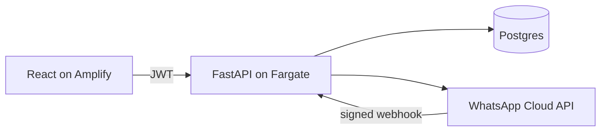
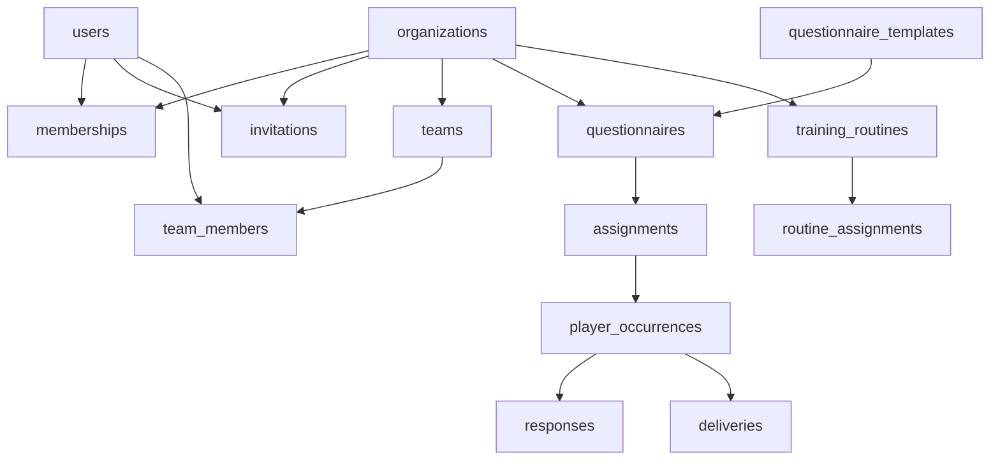
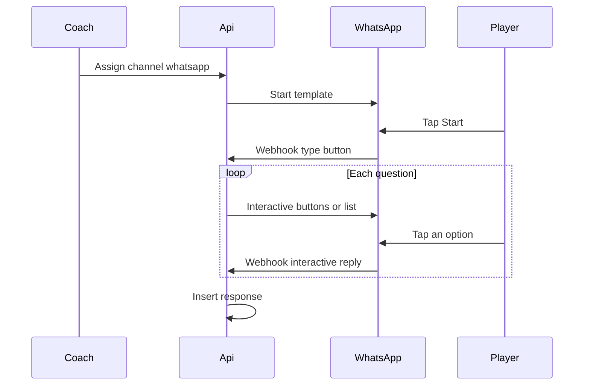

# Pep MVP technical design

Status: ready for review. Implementation has not started.

This document is the source of truth for the MVP. An implementation agent takes one slice, reads that slice plus the shared sections below, and stops. Later slices are out of scope for that session.

Product source: the Pep PRD (MVP). Where this document and the PRD disagree, this document wins. Those disagreements are listed under [Locked decisions](#locked-decisions).

## How to implement a slice

1. Read [Shared architecture](#shared-architecture) through [Authorization](#authorization), then the slice you were assigned.
2. Implement only that slice. Leave later tables, routes, and screens unbuilt.
3. Put business rules in services. Routers validate input, call a service, and return a schema. Repositories are the only place that queries the database.
4. Add an Alembic migration for every schema change. Do not edit a migration that has already been applied in a shared environment.
5. Prove the slice with the tests listed in it. Run the API tests against Postgres, not SQLite.
6. When the slice has a screen, exercise that screen in the browser: the happy path and the failure the tests cover.
7. Do not add a public signup route, a demo mode, response edits, or a second role system on teams.

Suggested agent prompt:

```text
Implement Slice N from docs/technical-design.md in /Users/Chubiyojo/Documents/PEP.
Follow the shared architecture and only the work described in that slice.
Do not implement later slices. Finish by running the slice tests.
```

## Product loop

A Superadmin creates a club and registers a club admin. The club admin registers a coach. The coach creates a team, registers players, and sends a questionnaire. The player answers in the WhatsApp thread or in the app. The response is stored once. The coach sees completion, averages, and attention flags, reminds players who have not answered, and assigns a training routine the player can mark complete.

## Locked decisions

- Tenancy is one shared Postgres database and one shared schema. Every club-owned row carries `organization_id`. Staging and production are separate deployments with separate databases. There is no demo/real column.
- An organization is a club. There is no organization type and no coach workspace.
- Identity is `users`, `organizations`, and `memberships`. `users.platform_role` is set only for a Superadmin. Club roles live only on `memberships`: `CLUB_ADMIN`, `COACH`, or `PLAYER`. A person belongs to one club.
- Teams are rosters. `team_members` has no role column.
- There is no public signup. A Superadmin registers a club admin. A club admin registers a coach. A coach registers a player. Each person sets their own password from an invitation link, then receives a JWT.
- A club has many questionnaires. Questions are a JSONB list on the questionnaire row.
- A submitted response is immutable. The API has no update or delete route. A database trigger rejects `UPDATE` and `DELETE`.
- WhatsApp collects the survey in the thread with buttons and lists. Typed WhatsApp messages are not answers. `short_text` is allowed in the app and cannot be assigned to WhatsApp.
- Dashboard authentication is a JWT access token and a rotating refresh token. No session cookies. Amplify is static hosting only: no Amplify Auth, Data, or Cognito.
- The API runs as a long-lived container. Lambda is not the MVP host.

Out of scope for the whole MVP: demo mode, coach or player self-signup, club self-signup, KYC, multiple club admins, Telegram, WhatsApp Flows, wearables, GPS, medical records, payments, social features, and AI coaching.

## Shared architecture



Local development uses Compose for Postgres, the API, and the web app. Staging, built in Slice 13, uses the same API image on ECS Fargate, RDS Postgres, and Amplify Hosting for the static web build.

### Repository layout

```text
apps/api/                 FastAPI, SQLAlchemy 2, Alembic, Pydantic v2
apps/web/                 Vite, React, TypeScript, React Router, TanStack Query
infra/                    Terraform, added in Slice 13
compose.yaml
docs/technical-design.md
```

API layout:

```text
apps/api/app/main.py
apps/api/app/core/        config, security, dependencies
apps/api/app/db/          session, base
apps/api/app/models/
apps/api/app/schemas/
apps/api/app/services/
apps/api/app/repositories/
apps/api/app/api/v1/
apps/api/alembic/
apps/api/tests/
```

Domain modules do not import Mangum, boto3, or the WhatsApp HTTP client. WhatsApp is behind a small port introduced in Slice 10. A dev adapter records outbound messages in memory so tests do not call Meta.

### Stack

- Python 3.12, FastAPI, SQLAlchemy 2, Alembic, Pydantic v2, psycopg 3
- Password hashing: Argon2
- Postgres 16
- Node 22, React, Vite, TypeScript
- API tests: pytest and HTTPX
- Lint: Ruff

### API conventions

- Prefix: `/api/v1`.
- JSON requests and responses. IDs are UUID strings.
- Timestamps are timezone-aware UTC.
- Authenticated calls send `Authorization: Bearer <access-token>`.
- `401` means missing or invalid credentials. `403` means the caller is authenticated and the role cannot perform the action. `404` means the row does not exist or is outside the caller's club, team, or self. Do not use `403` for a cross-club id.
- A second submit of a finished occurrence returns `409`.
- List endpoints are unpaginated. Pilot clubs are small. Do not add pagination in the MVP slices.
- FastAPI's generated OpenAPI schema is written to `apps/api/openapi.json`. The web app generates TypeScript types from that file. Commit both the schema and the generated types when a slice changes the API.

### Configuration

Slice 0 introduces:

| Variable | Purpose |
| --- | --- |
| `DATABASE_URL` | Postgres connection string |
| `JWT_SECRET` | HMAC secret for access tokens |
| `ACCESS_TOKEN_MINUTES` | Default 15 |
| `REFRESH_TOKEN_DAYS` | Default 14 |
| `CORS_ORIGINS` | Comma-separated web origins |
| `APP_PUBLIC_URL` | Base URL used in invitation links |

Later slices add variables only in the slice that needs them.

## Data model

Club-owned tables include `organization_id` and are always filtered with the principal. Platform tables are `users` (login) and `questionnaire_templates`.



Create tables in the slice that first needs them. Column lists below are the final shape.

### users

Slice 2.

| Column | Type | Notes |
| --- | --- | --- |
| `id` | uuid pk | `gen_random_uuid()` |
| `email` | citext unique not null | |
| `password_hash` | text null | Null while the invitation is open |
| `name` | text not null | |
| `phone_e164` | text null unique | Required before a WhatsApp assignment |
| `status` | text not null | `invited`, `active`, `deactivated` |
| `platform_role` | text null | Only `SUPERADMIN`, otherwise null |
| `created_at` | timestamptz not null | |
| `updated_at` | timestamptz not null | |

### organizations

Slice 2. This table stores clubs.

| Column | Type | Notes |
| --- | --- | --- |
| `id` | uuid pk | |
| `name` | text not null | |
| `sport` | text null | |
| `country` | text null | |
| `location` | text null | |
| `logo_url` | text null | |
| `contact_email` | text null | |
| `status` | text not null | `active`, `inactive` |
| `created_at` | timestamptz not null | |
| `updated_at` | timestamptz not null | |

### memberships

Slice 2.

| Column | Type | Notes |
| --- | --- | --- |
| `id` | uuid pk | |
| `user_id` | uuid fk users not null | |
| `organization_id` | uuid fk organizations not null | |
| `role` | text not null | `CLUB_ADMIN`, `COACH`, `PLAYER` |
| `status` | text not null | `invited`, `active`, `deactivated` |
| `created_at` | timestamptz not null | |

Constraints: unique `(user_id, organization_id)`. Unique `(user_id)` where `status <> 'deactivated'`, so a person belongs to one club. Unique `(organization_id)` where `role = 'CLUB_ADMIN'` and `status <> 'deactivated'`.

### refresh_tokens

Slice 2.

| Column | Type | Notes |
| --- | --- | --- |
| `id` | uuid pk | |
| `user_id` | uuid fk users not null | |
| `token_hash` | text unique not null | Store a hash, never the raw token |
| `expires_at` | timestamptz not null | |
| `revoked_at` | timestamptz null | |
| `created_at` | timestamptz not null | |

### invitations

Slice 3.

| Column | Type | Notes |
| --- | --- | --- |
| `id` | uuid pk | |
| `user_id` | uuid fk users not null | |
| `organization_id` | uuid fk organizations not null | |
| `role` | text not null | Same values as membership role |
| `team_id` | uuid null | Set when a coach registers a player onto a team. Slice 4 adds the foreign key |
| `token_hash` | text unique not null | |
| `expires_at` | timestamptz not null | 7 days |
| `accepted_at` | timestamptz null | |
| `created_by` | uuid fk users not null | |
| `created_at` | timestamptz not null | |

The raw token appears once, in the invitation link: `{APP_PUBLIC_URL}/accept-invite?token=...`. Delivery is a port. The dev adapter logs the link. Do not integrate an email provider in the MVP slices.

### teams and team_members

Slice 4.

`teams`: `id`, `organization_id`, `name`, `created_by`, `created_at`. Unique `(organization_id, name)`.

`team_members`: `team_id`, `user_id`, `created_at`. Primary key `(team_id, user_id)`. No role column. The user's role is their membership in the club.

### questionnaire_templates and questionnaires

Slice 5.

`questionnaire_templates`: `id`, `key` unique, `name`, `description`, `questions` jsonb, `schema_version` int. Seeded, not club-owned.

`questionnaires`:

| Column | Type | Notes |
| --- | --- | --- |
| `id` | uuid pk | |
| `organization_id` | uuid fk not null | |
| `template_id` | uuid fk null | |
| `version` | int not null | Starts at 1 |
| `supersedes_id` | uuid fk questionnaires null | Previous version |
| `name` | text not null | |
| `description` | text null | |
| `questions` | jsonb not null | Validated by Pydantic |
| `schema_version` | int not null | |
| `created_by` | uuid fk users not null | |
| `locked_at` | timestamptz null | Set when the first assignment is created |
| `created_at` | timestamptz not null | |

Question document:

```json
{
  "schema_version": 1,
  "questions": [
    {
      "id": "sleep",
      "prompt": "How did you sleep?",
      "type": "rating",
      "min": 1,
      "max": 5,
      "required": true
    },
    {
      "id": "ready",
      "prompt": "Ready to train?",
      "type": "yes_no",
      "required": true
    }
  ]
}
```

Allowed `type` values:

| Type | Shape | WhatsApp |
| --- | --- | --- |
| `yes_no` | no extra fields | Reply buttons, titles `Yes` and `No` |
| `rating` | `min` 1 and `max` 5 only | List rows titled `1` through `5` |
| `single_choice` | `options` array of `{id, label}`, 1 to 10 items, label at most 24 characters | List rows |
| `short_text` | `max_length` default 280 | Not allowed on a WhatsApp assignment |

Question `id` values are unique inside one questionnaire and match `^[a-z][a-z0-9_]{0,40}$`.

Editing a questionnaire with `locked_at` set creates a new row with `version + 1` and `supersedes_id` pointing at the locked row. Assignments keep the old snapshot.

### assignments, targets, occurrences, responses

Slice 6, except the WhatsApp columns are used in Slice 10.

`assignments`:

| Column | Type | Notes |
| --- | --- | --- |
| `id` | uuid pk | |
| `organization_id` | uuid fk not null | |
| `questionnaire_id` | uuid fk not null | |
| `questions_snapshot` | jsonb not null | Copy of questions at assignment time |
| `created_by` | uuid fk users not null | |
| `target_type` | text not null | `team` or `players` |
| `team_id` | uuid fk null | Required when target is `team` |
| `schedule` | text not null | `once`, `daily`, `weekly`. Only `once` is implemented before Slice 11 |
| `due_at` | timestamptz null | Required for `once` |
| `starts_on` | date null | Used by Slice 11 recurrence |
| `ends_on` | date null | |
| `channel` | text not null | `in_app` or `whatsapp` |
| `created_at` | timestamptz not null | |

`assignment_targets`: primary key `(assignment_id, user_id)`. Expanded from the team roster at assignment time so later roster edits do not change who was asked.

`player_occurrences`:

| Column | Type | Notes |
| --- | --- | --- |
| `id` | uuid pk | |
| `assignment_id` | uuid fk not null | |
| `organization_id` | uuid fk not null | |
| `player_id` | uuid fk users not null | |
| `window_start` | timestamptz not null | For `once`, the assignment time |
| `status` | text not null | `pending`, `in_progress`, `completed`, `missed` |
| `cursor` | int not null default 0 | Next WhatsApp question index |
| `draft_answers` | jsonb not null default `{}` | Not a response |
| `due_at` | timestamptz null | |
| `created_at` | timestamptz not null | |

Unique `(assignment_id, player_id, window_start)`.

`responses`:

| Column | Type | Notes |
| --- | --- | --- |
| `id` | uuid pk | |
| `occurrence_id` | uuid unique fk not null | |
| `organization_id` | uuid fk not null | |
| `player_id` | uuid fk users not null | |
| `channel` | text not null | `in_app` or `whatsapp` |
| `answers` | jsonb not null | |
| `questions_snapshot` | jsonb not null | |
| `submitted_at` | timestamptz not null | |

Trigger: before `UPDATE` or `DELETE`, raise an exception. Application code only inserts.

Answer object is a map of question id to value. Rating is an integer. `yes_no` is a boolean. `single_choice` is the option id. `short_text` is a string. Reject unknown ids, missing required answers, and out-of-range values.

### deliveries

Slice 10. Slice 11 writes reminder rows into the same table.

| Column | Type | Notes |
| --- | --- | --- |
| `id` | uuid pk | |
| `occurrence_id` | uuid fk not null | |
| `channel` | text not null | |
| `kind` | text not null | `survey_start`, `question`, `reminder` |
| `status` | text not null | `queued`, `sent`, `delivered`, `read`, `responded`, `failed` |
| `provider_message_id` | text null | Meta message id |
| `created_at` | timestamptz not null | |

### training_routines and routine_assignments

Slice 9.

`training_routines`: `id`, `organization_id`, `team_id` null, `created_by`, `name`, `description`, `objective`, `exercises` jsonb, `duration_minutes` int, `intensity` text null, `frequency` text null, `start_date`, `end_date` null, `instructions` text null, `created_at`.

Exercise item: `{"name": "Light cycling", "duration_minutes": 10}`.

`routine_assignments`: `id`, `routine_id`, `player_id`, `organization_id`, `status`, `updated_at`. Status is `not_started`, `in_progress`, or `completed`. Unique `(routine_id, player_id)`. A player may change status only forward: `not_started` to `in_progress` to `completed`.

## Authorization

Access tokens are JWTs signed with HS256. Claims are `sub` (user id), `exp`, and `typ=access`. Roles are not trusted from the token. The auth dependency loads the user, active memberships, and team ids from the database on each request.

Refresh tokens are random URL-safe strings. Only the hash is stored. Refresh revokes the presented token and issues a new pair. Login of an `invited` or `deactivated` user returns `401`.

Principal:

- `user_id`
- `platform_role`
- memberships: club id, role, status
- `team_ids` for teams the user belongs to

Rules:

| Action | Who |
| --- | --- |
| Create a club, register a club admin, list clubs | Superadmin |
| Register or deactivate a coach, see club aggregate metrics | Club admin of that club |
| Create a team, register a player, write questionnaires, assign surveys and routines, remind | Coach of that club, and only for teams they belong to |
| Answer an occurrence, update own routine status, read own history | The player on that occurrence or routine |
| Read individual player answers | Coach on a shared team. Club admin and Superadmin see aggregates only |

A coach who is not on the team gets `404` for that team's players and occurrences. A player gets `404` for another player's response.

Deactivating a membership leaves historical responses in place and rejects new logins for that membership's actions. The user row stays.

## WhatsApp behavior

Used by Slice 10 and Slice 11. Meta allows a business to send a free-form or interactive message only inside the 24-hour window that opens when the player messages the business or taps a template button. Outside that window the API sends an approved template.

Two utility templates, approved in Meta before staging:

- Start template. Body parameters: player name, questionnaire name. One quick reply, payload `START`.
- Reminder template. Same parameters. One quick reply, payload `START`.

Flow:



State:

- On assign, create occurrences in `pending` and a `survey_start` delivery. Send the start template. Do not send question one yet.
- A `START` tap from a phone number selects that player's latest occurrence in `pending` or `in_progress`. If it is `pending`, set `in_progress` and send question `cursor`.
- `yes_no` is an interactive reply-button message. `rating` and `single_choice` are interactive list messages.
- Reply ids are `{occurrence_id}:{question_id}:{value}`. `value` is `yes`, `no`, the rating digit, or the option id.
- Accept a reply only when `question_id` is the question at `cursor`. Append `draft_answers`, increment `cursor`, and send the next question.
- When `cursor` reaches the question count, insert `responses`, set the occurrence to `completed`, and send a short completion message inside the open window.
- A typed message, or a reply for a different question, resends the current question and does not change `draft_answers`.
- A tap after `completed` sends "Already submitted" and does not write a row.
- An in-app submit of an in-progress occurrence inserts the response and completes it. Later taps get "Already submitted".

Webhook:

- `GET /api/v1/webhooks/whatsapp` answers Meta's verification challenge.
- `POST /api/v1/webhooks/whatsapp` requires a valid `X-Hub-Signature-256` over the raw body using `WHATSAPP_APP_SECRET`. Invalid signatures return `401`.
- Resolve the player by `users.phone_e164` equal to the sender, compared in E.164 digits.
- Template button taps arrive as message `type=button`. Session taps arrive as `type=interactive` with `button_reply` or `list_reply`.
- Status webhooks update `deliveries.status` by `provider_message_id`.

Assignment to WhatsApp fails with `422` when any question has type `short_text`, or when a target player has no `phone_e164`.

Configuration added in Slice 10: `WHATSAPP_TOKEN`, `WHATSAPP_PHONE_NUMBER_ID`, `WHATSAPP_APP_SECRET`, `WHATSAPP_VERIFY_TOKEN`, `WHATSAPP_TEMPLATE_START`, `WHATSAPP_TEMPLATE_REMINDER`.

## Web application

Routes, added by the slice that needs them:

| Path | Slice | Who |
| --- | --- | --- |
| `/login` | 1 | anyone |
| `/accept-invite` | 2 | invited user |
| `/admin/clubs` | 2 | Superadmin |
| `/club/coaches` | 2 | Club admin |
| `/teams` | 3 | Coach |
| `/questionnaires` | 4 | Coach |
| `/assignments/new` | 5 | Coach |
| `/player` | 5 | Player, pending form |
| `/dashboard` | 6 | Coach |
| `/player/history` | 7 | Player |
| `/routines` | 8 | Coach and player |
| `/club` | 11 | Club admin aggregates |

The web app stores the access token and refresh token in memory and `sessionStorage`. On `401`, it calls the refresh endpoint once and retries. A failed refresh sends the user to `/login`.

Screens in each slice are functional forms and lists. Do not introduce a component library in these slices.

## Slice 0 — Walking skeleton

Depends on: nothing.

Build:

- `compose.yaml` with Postgres 16, the API, and the web dev server. API and web reload on the host source mount.
- FastAPI app with `GET /api/v1/health` returning `{"status": "ok"}`.
- Alembic configured and able to run an empty initial revision.
- Vite React app that requests the health endpoint and shows the status.
- Script that writes `apps/api/openapi.json` and generates the web types.
- One pytest that boots the app with the test database and asserts the health payload.

Done when:

- `docker compose up` serves the API and the web app.
- The browser shows the health status from the API.
- `pytest` passes against Postgres.
- OpenAPI generation runs without a hand-written client.

## Slice 1 — Identity

Depends on: Slice 0.

Build:

- Tables `users`, `organizations`, `memberships`, `refresh_tokens`.
- Startup seed: if no Superadmin exists, create one from `SUPERADMIN_EMAIL` and `SUPERADMIN_PASSWORD`.
- `POST /api/v1/auth/login` with email and password. Returns `access_token`, `refresh_token`, and `token_type`.
- `POST /api/v1/auth/refresh` with `refresh_token`. Rotates the refresh token.
- `POST /api/v1/auth/logout` revokes the presented refresh token.
- `GET /api/v1/me` returns the user id, name, email, `platform_role`, and memberships.
- Auth dependency and a club-scoped repository helper.
- `/login` screen. After login, show the caller's name and role.

Tests:

- Login success and wrong password.
- Refresh rotation rejects the previous refresh token.
- `GET /me` without a token returns `401`.
- Insert two clubs and a coach membership in one club. A request for the other club's id returns `404`.

Done when a seeded Superadmin can log in, refresh, and call `/me`, and the cross-club test fails closed.

## Slice 2 — Club entry

Depends on: Slice 1.

Build:

- Table `invitations`.
- Invitation service: create invited user if the email is new, or reject the email if that user already has a membership in another club. Create the membership in `invited`. Return the invite link via the log adapter.
- `POST /api/v1/organizations` Superadmin only. Body: club fields plus `admin_name` and `admin_email`. Creates the club and the club-admin invitation.
- `GET /api/v1/organizations` Superadmin only. Name, status, and admin email. No player data.
- `POST /api/v1/organizations/{organization_id}/coaches` Club admin of that club. Body: `name`, `email`. Creates a `COACH` invitation.
- `POST /api/v1/auth/accept-invite` Body: `token`, `password`. Sets the password, marks the user and membership `active`, marks the invitation accepted, and returns a JWT pair. Passwords are at least 8 characters. Expired or reused tokens return `400`.
- Screens: Superadmin club list and create form. Club admin coach registration form. Accept-invite page.
- There is no `POST /auth/register`.

Tests:

- Superadmin creates a club. A second club admin for the same club returns `409`.
- Club admin registers a coach. The coach cannot log in before accepting.
- Accepting the invite lets the coach call `/me` and see the `COACH` membership.
- A coach calling `POST /organizations` returns `403`.
- An invitation token is stored only as a hash.

Done when the path Superadmin, club, club admin, coach, first JWT works in the browser, and no public signup route exists.

## Slice 3 — Teams and players

Depends on: Slice 2.

Build:

- Tables `teams` and `team_members`. Add `invitations.team_id`.
- `POST /api/v1/teams` Coach. Body: `name`. The coach is added to `team_members`.
- `GET /api/v1/teams` Coach, only their teams. Club admin, all teams in the club without player response data.
- `POST /api/v1/teams/{team_id}/players` Coach on that team. Body: `name`, `email`, `phone_e164` optional. Creates a `PLAYER` membership and invitation, and a roster row.
- Accept-invite for a player activates the membership. The roster row already exists.
- `GET /api/v1/teams/{team_id}` returns the roster for a coach on that team.
- Screens: team list, create team, register player, player accept-invite landing on an empty home.

Tests:

- A coach not on the team receives `404` for that team.
- A player membership cannot create a team.
- Registering a player twice in the same club returns `409`.
- Phone values are stored in E.164 or the request returns `422`.

Done when a coach can create a team, register a player, and the player can accept the invite and see an empty home.

## Slice 4 — Questionnaires

Depends on: Slice 3.

Build:

- Tables `questionnaire_templates` and `questionnaires`.
- Seed four templates: `daily_readiness`, `weekly_wellness`, `post_match_recovery`, `training_load`. Each uses rating questions only.
- `GET /api/v1/questionnaire-templates` Coach.
- `POST /api/v1/questionnaires` Coach. Body: `name`, `description`, `questions`, optional `template_id`. The service validates the question document.
- `GET /api/v1/questionnaires` Coach, current club, latest version of each lineage.
- `PATCH /api/v1/questionnaires/{id}` Coach and author club. If `locked_at` is null, update in place. If it is set, insert the next version.
- Screen: template list, clone, and a form to add questions of each type.

Tests:

- A rating question with a max other than 5 returns `422`.
- A `single_choice` with 11 options returns `422`.
- A coach in another club gets `404` for this club's questionnaire.
- A player gets `403` on create.

Done when a coach can clone Daily Readiness and save a custom questionnaire with a yes/no question.

## Slice 5 — Assign and answer in the app

Depends on: Slice 4.

Build:

- Tables `assignments`, `assignment_targets`, `player_occurrences`, `responses`, including the immutability trigger.
- `POST /api/v1/assignments` Coach. Body: `questionnaire_id`, `target_type`, `team_id` or `player_ids`, `due_at`, `channel`. Slice 5 accepts `channel=in_app` and `schedule=once` only. Other values return `422`.
- Creating an assignment locks the questionnaire, copies `questions_snapshot`, expands targets, and inserts one pending occurrence per player.
- `GET /api/v1/player/occurrences` Player. Pending and completed occurrences for themselves.
- `POST /api/v1/player/occurrences/{id}/responses` Player. Body: `answers`. Validates against the snapshot, inserts the response, sets the occurrence `completed`.
- A second post returns `409`. A direct SQL update of `responses` raises the trigger exception.
- Screens: coach assignment form. Player home lists pending questionnaires and submits one.

Tests:

- Assignment to a team creates one occurrence per current roster member.
- Missing a required answer returns `422` and leaves the occurrence pending.
- Second submit returns `409`.
- A player cannot submit another player's occurrence (`404`).
- `channel=whatsapp` returns `422` in this slice.

Done when a coach assigns a questionnaire to a team and a player submits it once in the browser.

## Slice 6 — Coach dashboard

Depends on: Slice 5.

Build:

- `GET /api/v1/teams/{team_id}/dashboard` Coach on that team.
- Response includes, for the selected questionnaire or the latest assignment:
  - completion count and roster size
  - per-question average for `rating` questions
  - per-question yes count for `yes_no`
  - option counts for `single_choice`
  - player rows: name, status, submitted time, channel, answers
  - attention flags, computed, not stored:
    - a rating answer of 4 or 5 on the same question id for two consecutive completed occurrences
    - the player has no completed response for their last two due occurrences
- `GET /api/v1/players/{player_id}` Coach who shares a team with that player. Occurrence history and answers. Club admin receives `404` on this route.
- Screen: team summary, flag list, and a player drill-down.

Tests:

- Averages match a fixture of three responses.
- Two consecutive high ratings produce one flag.
- A coach off the team receives `404`.
- A club admin token receives `404` on the player detail route.

Done when the coach can open the dashboard after Slice 5's submission and see that player's answers and the team completion count.

## Slice 7 — Player history

Depends on: Slice 6.

Build:

- Extend the player home with history: submitted questionnaires and, per rating question, the last five values in order.
- `GET /api/v1/player/history` returns only the caller's responses and occurrences.
- Screen shows today's pending items and past submissions.

Tests:

- A player token cannot read another player's history (`404`).
- History order is `submitted_at` descending.

Done when the player who submitted in Slice 5 can see that submission on their home screen.

## Slice 8 — Training routines

Depends on: Slice 7.

Build:

- Tables `training_routines` and `routine_assignments`.
- `POST /api/v1/routines` Coach. Body matches the routine columns. `team_id` or `player_ids` expands assignments in `not_started`.
- `GET /api/v1/routines` Coach, their teams. Player, their assignments.
- `POST /api/v1/player/routines/{assignment_id}/status` Player. Body: `status`. Only the forward transitions are accepted.
- Add routine counts to the coach dashboard: assigned, in progress, completed.
- Screens: coach create form, player routine list with the status action.

Tests:

- A player cannot move `not_started` directly to `completed` (`422`).
- A player cannot update another player's assignment (`404`).
- The dashboard count increases after a valid transition.

Done when a coach assigns a routine and the player marks it in progress, then completed, and the coach sees the new count.

## Slice 9 — WhatsApp

Depends on: Slice 8.

Build:

- Table `deliveries`.
- Channel port with a Meta adapter and an in-memory adapter. Tests use the in-memory adapter.
- Allow `channel=whatsapp` on create assignment, with the `short_text` and phone checks from [WhatsApp behavior](#whatsapp-behavior).
- Webhook verify and receive routes.
- State machine implemented as a service used by the webhook, covered without network calls.
- Record a delivery per start template and per question message.
- Apply status callbacks onto deliveries.
- Show the response channel on the coach dashboard. Slice 5 already stores `channel`.

Tests, using fixture webhook bodies:

- Start tap moves `pending` to `in_progress` and records the first question payload.
- A list reply for the current question stores a draft and advances the cursor.
- A text message does not change `draft_answers`.
- The last answer inserts one response and a second tap does not insert another.
- A bad signature returns `401`.
- A questionnaire containing `short_text` cannot be assigned to WhatsApp.

Done when the test suite completes a three-question survey through webhook fixtures, and a manual test against Meta is documented with the required template names. The manual Meta test is not required for the automated done check.

## Slice 10 — Reminders

Depends on: Slice 9.

Build:

- `POST /api/v1/internal/reminders` authenticated by header `X-Cron-Secret` matching `CRON_SECRET`. No JWT.
- The job selects occurrences in `pending` or `in_progress` whose `due_at` is within the past 24 hours and that have no `reminder` delivery in that window. It sends the reminder template and inserts a delivery row.
- `POST /api/v1/occurrences/{id}/remind` Coach on the team. Same cap. A second call inside the window returns `409`.
- Mark an occurrence `missed` when `due_at` is more than 24 hours ago and status is still `pending`.
- Dashboard remind button on non-responders.
- `schedule` of `daily` or `weekly` creates the next occurrence when the job runs, copying the assignment snapshot and the current targets. Do this only if the previous window has closed.

Tests:

- Two job runs create one reminder delivery.
- The coach remind route returns `409` on the second call.
- An old pending occurrence becomes `missed`.

Done when a non-responder appears on the dashboard and the remind action sends one recorded reminder.

## Slice 11 — Admin views

Depends on: Slice 10.

Build:

- `GET /api/v1/organizations/{id}/metrics` Club admin of that club, and Superadmin. Counts of coaches, players, active players, questionnaire completion across the club, and routine completion. No answer payloads and no per-player answer lists.
- `POST /api/v1/organizations/{id}/coaches/{user_id}/deactivate` Club admin. Sets that coach membership to `deactivated`.
- `POST /api/v1/organizations/{id}/players/{user_id}/deactivate` Club admin or a coach who shares a team with the player.
- Superadmin club screen links to the aggregate metrics and still has no player drill-down.
- Club admin home shows the metrics.

Tests:

- Metrics match a fixture and the payload contains no `answers` field.
- A coach receives `404` on another club's metrics.
- Login as a deactivated user returns `401`. A still-valid access token loses the coach membership on the next request, and `POST /assignments` returns `403`.

Done when a club admin can open the club home and see completion counts after the coach loop has data.

## Slice 12 — Staging

Depends on: Slice 11. This slice is infrastructure. Do not start it before the API slices above are accepted.

Build in `infra/` with Terraform:

- One staging environment in one AWS account.
- ECS Fargate service, 0.25 vCPU and 0.5 GB, one task, public subnet, public IP. No NAT gateway.
- RDS Postgres, `db.t4g.micro`, private subnets, security group open only to the task security group.
- API image from the same Dockerfile Compose uses.
- Amplify Hosting app for `apps/web`, staging branch, `VITE_API_URL` set to the staging API origin. Static hosting only.
- SSM parameters for the API secrets. The task role can read them.
- EventBridge schedule calling `POST /api/v1/internal/reminders` with `CRON_SECRET`.
- FastAPI `CORS_ORIGINS` includes the Amplify staging origin.
- Public HTTPS URL for the WhatsApp webhook.

Production is the same module with a second workspace, a second database, and a second Amplify branch. Do not apply production in this slice.

Done when a staging health check succeeds, the staging web app logs in against the staging API, and the webhook URL is reachable from the public internet.

## Slice order

Implement in this order. Each slice assumes the previous one is merged.

| Slice | Name | First user-visible result |
| --- | --- | --- |
| 0 | Walking skeleton | Health status on the web app |
| 1 | Identity | Superadmin can log in |
| 2 | Club entry | Club admin can register a coach |
| 3 | Teams and players | Player can accept an invite |
| 4 | Questionnaires | Coach can save a questionnaire |
| 5 | Assign and answer | Player can submit once |
| 6 | Coach dashboard | Coach can see that submission |
| 7 | Player history | Player can see their past answers |
| 8 | Training routines | Player can complete a routine |
| 9 | WhatsApp | Survey completes from button taps |
| 10 | Reminders | Coach can remind one non-responder |
| 11 | Admin views | Club admin can see aggregates |
| 12 | Staging | Staging URL serves the app |

## References

- [FastAPI bigger applications](https://fastapi.tiangolo.com/tutorial/bigger-applications/)
- [SQLAlchemy 2 ORM quickstart](https://docs.sqlalchemy.org/en/20/orm/quickstart.html)
- [PostgreSQL JSON types](https://www.postgresql.org/docs/current/datatype-json.html)
- [WhatsApp template fundamentals](https://developers.facebook.com/docs/whatsapp/business-management-api/message-templates/)
- [WhatsApp send messages](https://developers.facebook.com/docs/whatsapp/cloud-api/guides/send-messages/)
- [Interactive reply buttons](https://developers.facebook.com/docs/whatsapp/cloud-api/messages/interactive-reply-buttons-messages)
- [Interactive list messages](https://developers.facebook.com/docs/whatsapp/cloud-api/messages/interactive-list-messages)
- [Production FastAPI on Lambda or ECS](https://slchow.com/en/notes/production-fastapi-on-aws)
- [AWS Fargate or Lambda](https://docs.aws.amazon.com/decision-guides/latest/decision-guides/fargate-or-lambda.html)
- [Amplify Hosting](https://docs.aws.amazon.com/amplify/latest/userguide/welcome.html)
- [openapi-typescript](https://openapi-ts.dev/)
